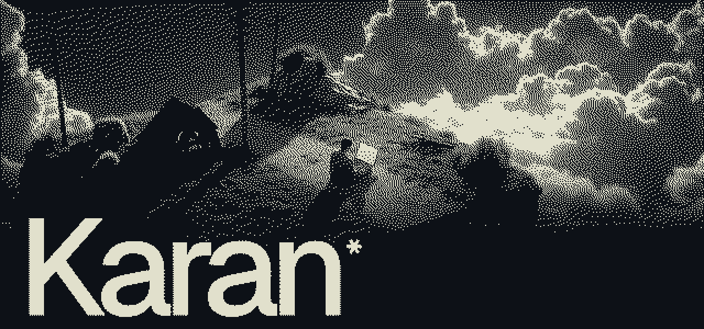
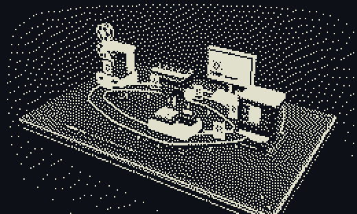

<h2 align="center">Ciao 👋, sono Karan</h2>

<b>Sviluppatore full-stack · Integrazioni AI · Mantova</b>

<code>software · ai · automation</code>

  
  

---

### 🛠️ Cosa faccio

- **Gestionali su misura** — magazzino, presenze, ferie, note spese: tutto in un posto, dal PC o dal telefono.
- **Automazioni** — report Excel e PDF, fatture elettroniche, passaggi ripetitivi che si fanno da soli.
- **Integrazioni AI** — assistenti vocali e chatbot che conoscono i dati dell'azienda.
- **Siti e landing page** veloci, chiari e pensati per convertire.

 

### 🚀 Progetti in evidenza

| Progetto | Cosa fa |
|---|---|
| [**Aria**](https://karandev.it/it/progetti/aria) | Gestionale magazzino con assistente vocale AI, in uso in 3 punti vendita |
| [**FormaliaSuite HR**](https://karandev.it/it/progetti/formaliasuite-hr) | Presenze, ferie, note spese e badge QR in un solo gestionale |
| [**Orbit**](https://karandev.it/it/progetti/orbit) | Hub di automazioni per la formazione: ~20 ore al mese risparmiate |
| [**Costo Personale**](https://karandev.it/it/progetti/costo-personale) | Quanto costa davvero un dipendente, prima di assumerlo |
| [**Watty**](https://karandev.it/it/progetti/watty) | Energia solare usata al momento giusto · 🥉 3° posto hackathon |
| [**Mincio**](https://karandev.it/it/progetti/mincio) | Leggere le acque del territorio mantovano · hackathon 2026 |

👉 Tutti i progetti con foto e dettagli su **[karandev.it](https://karandev.it)**

### 🧰 Stack

  

AI: Claude · ElevenLabs · integrazioni LLM e assistenti vocali

### 📍 Ora

- 💼 Senior Full-Stack Developer · AI Integration
- 🎓 Studio Ingegneria Informatica
- 🔨 Sto lavorando a FormaliaSuite HR e a qualcosa di nuovo… 👀

---

🇬🇧 Full-stack & AI integration developer based in Mantua, Italy. Custom management software, automations and AI assistants. Portfolio: <a href="https://karandev.it/en">karandev.it/en</a>

